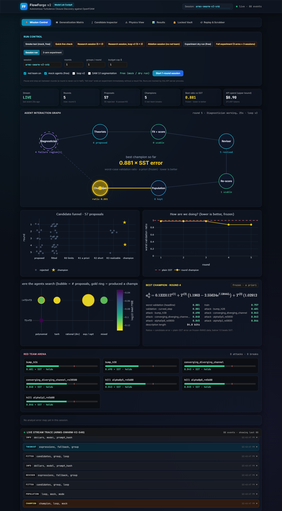
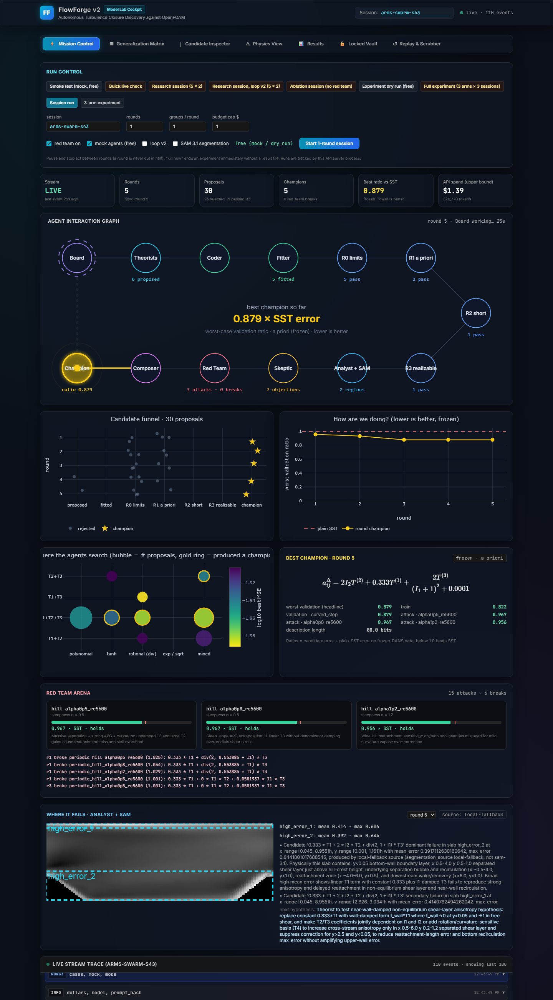
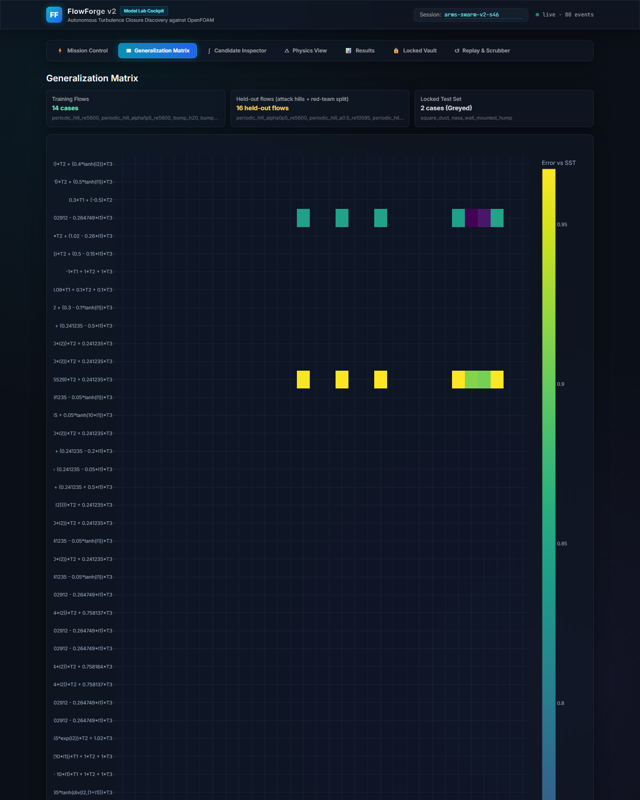
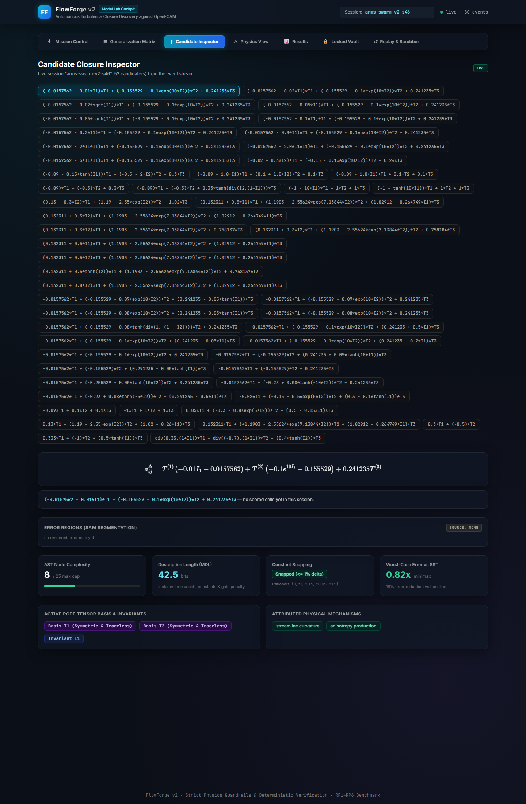
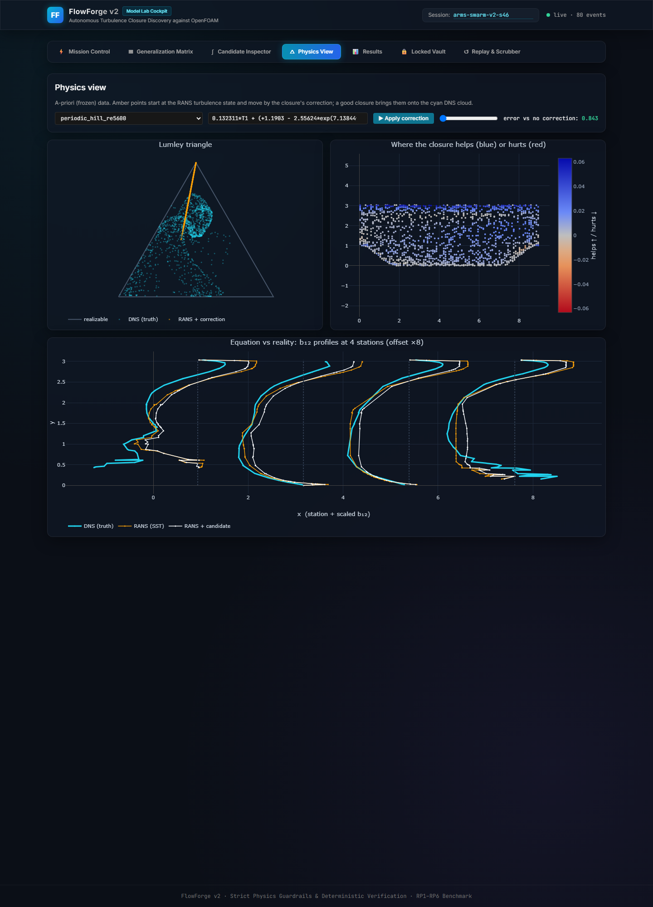
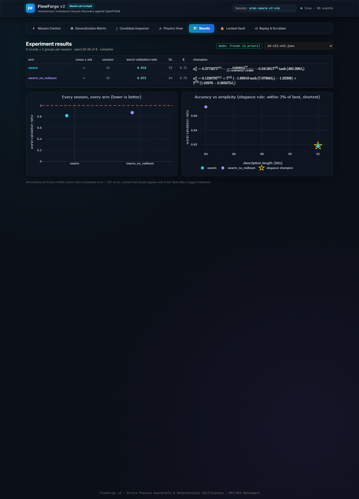
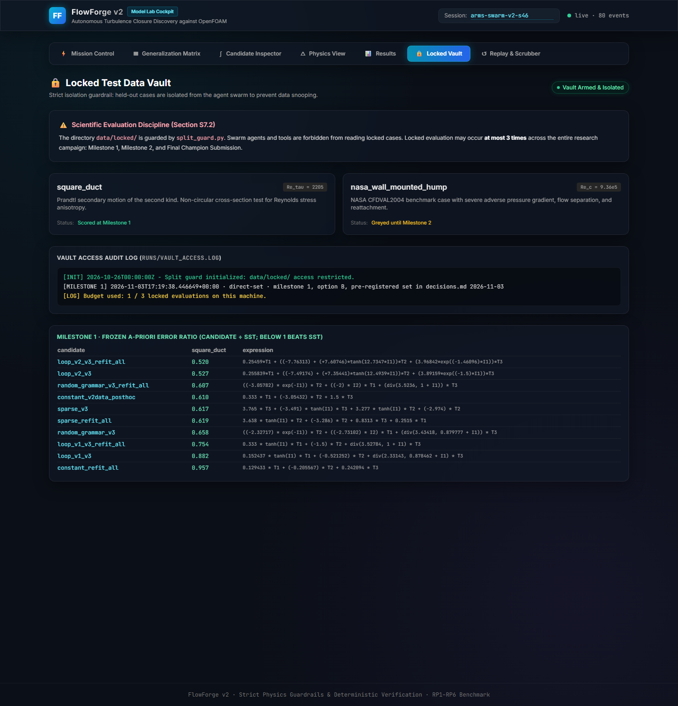
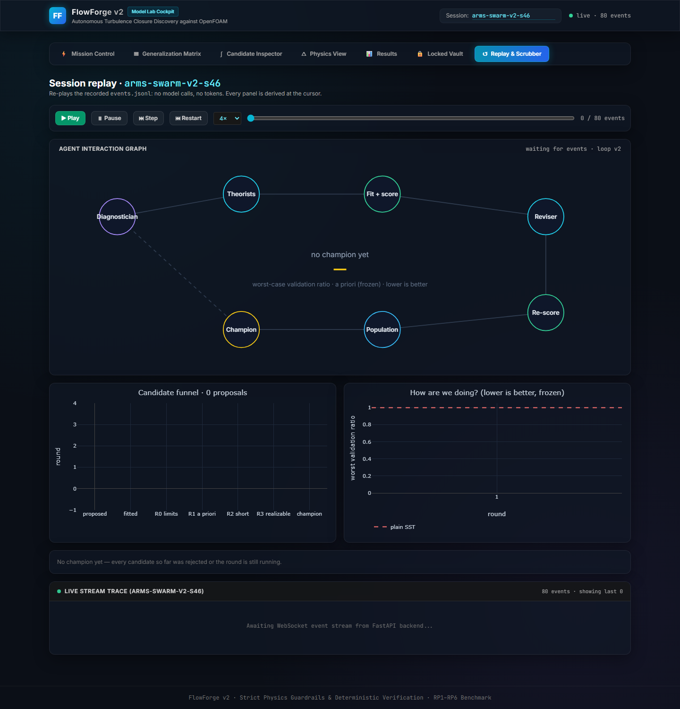

# FlowForge v2

**LLM research agents that propose turbulence-closure corrections for the k-ω SST RANS model, a
deterministic evaluation ladder that scores every proposal, and a live cockpit that shows the whole
process.** Agents write candidate closures in a small, checkable language; constants are fitted by
least squares; every claim is decided by a deterministic score, never by an LLM.

> **Headline (locked test, frozen a priori, one case).** On the held-out 3-D `square_duct`, the
> closure found by **loop v2** cuts SST's anisotropy error by **47 %**
> (error ratio 0.527), ahead of classical sparse regression (0.618), random grammar search (0.658)
> and the original agent loop (0.882). The ranking matches the validation ranking. One locked case,
> frozen a-priori scores (not solved velocity), one champion per approach — see
> [Limits](#limits-read-before-quoting-a-number).



Methodology authority: [docs/build-spec.md](docs/build-spec.md). Sequencing:
[docs/plans/2026-10-26-flowforge-v2-implementation-plan.md](docs/plans/2026-10-26-flowforge-v2-implementation-plan.md).
Every protocol change and every result, wins and losses, is logged in
[docs/history/decisions.md](docs/history/decisions.md), registered before it was computed.

---

## Contents

1. [What it does](#what-it-does)
2. [Two agent loops](#two-agent-loops)
3. [Results](#results)
4. [What we learned](#what-we-learned)
5. [Limits](#limits-read-before-quoting-a-number)
6. [The cockpit (screenshots)](#the-cockpit)
7. [Setup and reproduction](#setup-and-reproduction)
8. [Repository layout](#repository-layout)
9. [Guardrails](#guardrails)
10. [Next steps](#next-steps)

---

## What it does

A candidate closure corrects SST's Reynolds-stress anisotropy with Pope's tensor basis:

$$a^{\Delta}_{ij} = g_1(I_1, I_2)\,T^{(1)}_{ij} + g_2(I_1, I_2)\,T^{(2)}_{ij} + g_3(I_1, I_2)\,T^{(3)}_{ij}$$

- **Closure language** (`flowforge/dsl/`): T1..T3 and invariants I1 (strain), I2 (rotation); `+ − ×`,
  guarded `div`/`sqrt`, `exp`, `tanh`, integer powers; at most **25 expression-tree nodes**. T4 and
  I3–I5 are rejected (redundant in 2-D). Invariance and dimensional consistency hold by construction.
- **Targets** (`flowforge/physics/frozen_rans.py`): frozen-RANS correction `a_delta = b_DNS − b_SST` from
  the curated McConkey RANS/DNS dataset (Kaggle, CC-BY-4.0).
- **Fitting** (`flowforge/dsl/expr_fit.py`): least squares on the training flows, realizability-constrained
  (total anisotropy stays inside the Lumley triangle), then constant snapping (0, ±½, ±1, … within 1 %).
- **Score**: error ratio = candidate MSE ÷ SST (zero-correction) MSE on a flow; below 1 beats SST.
- **Selection** (`flowforge/elegance/`): among candidates within 3 % of the best, the shortest
  description length wins (elegance rule, frozen).
- **Red team**: candidates worse than SST on any held-out attack flow are flagged/broken.
- **Locked vault** (`data/locked/`): read only by `scripts/evaluate_locked.py`, at most 3 logged
  evaluations.

### Data splits (data v3, current)

| Split | Flows | Use |
|---|---|---|
| train | periodic hills α 1.0, 1.5; parametric bumps h20, h31, h42; 9 zero-pressure-gradient flat plates | fit constants |
| redteam | converging-diverging channel (Re 12600, 20580); bumps h26, h38 | held-out screen / selection |
| attack hills | periodic hills α 0.5, 0.8, 1.2 | held-out screen / selection |
| validation | curved backward-facing step (`curved_step`) | the reported metric; never seen by an LLM |
| locked | `square_duct` (3-D), `nasa_wall_mounted_hump` | ≤ 3 milestone evaluations |

Data v2 (the decision run) trained on the two hills only; adding the bump and flat-plate families
(already in the downloaded dataset, never ingested before) was the single largest improvement.

## Two agent loops

Both loops share the fitter, scorer, realizability gate, elegance rule, event log and budget meter.
Choose with `scripts/run_arms.py --loop v1|v2` or the **loop v2** toggle in the UI.

**Loop v1 (original, 12 steps, `flowforge/orchestrator/round.py`).** Board → Theorists → Coder → Fitter →
Rung 0 → Rung 1 (halving) → red-team screen → Rung 2 → Rung 3 → Analyst + SAM → Skeptic → Composer →
Champion. Every role is one structured JSON call. Audit finding: Coder, Analyst, Skeptic and Composer
outputs are never read downstream, and in frozen mode rungs 1–3 apply the same metric three times.

**Loop v2 (`flowforge/orchestrator/loop_v2.py`).** Rewired so diagnosis drives proposal and the
proposer sees its results inside the round:

```
 ┌──────── population (top 8, ≤ 2 per tensor set, carried across rounds) ◄──────────┐
 ▼                                                                                   │
Diagnostician (LLM): reads per-flow scores of the population, names the worst flows │
 ▼                                                                                   │
Theorist ×G (LLM): 3 proposals per group from the diagnosis                          │
 ▼                                                                                   │
Fit + score (deterministic): constants on train; per-flow train and held-out ratios ─┤
 ▼                                                                                   │
Reviser (LLM, same group): sees its own per-flow scores, revises once ── re-score ───┘
                                     end of round: Champion (deterministic, same rule)
```

The red team becomes a score column (held-out ratios) instead of a mid-pipeline gate; Coder,
Composer, Skeptic and the LLM red team are not dispatched. **v2.1** adds a 50k-token completion
limit (8k left 11 % of replies empty), the parser's real rejection message (e.g. "Complexity 27
exceeds cap 25"), node counts and the realizable fraction in what the model sees.

## Results

All numbers are **frozen a-priori** error ratios (lower is better, 1.0 = plain SST), 5 seeds,
5 rounds × 2 groups per session, metric `worst_validation_ratio` on `curved_step`.

### Data v3 (current)

| Arm | Mean ± sd | Seeds 42 / 43 / 44 / 45 / 46 | Spend |
|---|---|---|---|
| Sparse regression (no LLM) | **0.748 ± 0.029** | 0.798 / 0.733 / 0.733 / 0.741 / 0.733 | $0 |
| Random grammar search (no LLM) | 0.784 ± 0.055 | 0.753 / 0.730 / 0.781 / 0.874 / 0.781 | $0 |
| Loop v2, swarm | 0.850 ± 0.105 | 0.961 / 0.841 / 0.821 / 0.932 / **0.694** | $6.79 (both v2 arms) |
| Loop v2, no red team | 0.869 ± 0.116 | 0.968 / 0.956 / 0.909 / 0.822 / **0.688** | |
| Loop v2.1, swarm | 0.868 ± 0.046 | 0.818 / 0.887 / 0.826 / 0.929 / 0.881 | $6.86 (both v2.1 arms) |
| Loop v2.1, no red team | 0.871 ± 0.032 | 0.872 / 0.861 / 0.926 / 0.845 / 0.852 | |
| Loop v1, no red team | 0.883 ± 0.043 | 0.868 / 0.852 / 0.955 / 0.890 / 0.851 | $6.43 (both v1 arms) |
| Loop v1, swarm | 0.939 ± 0.035 | 0.964 / 0.879 / 0.939 / 0.959 / 0.957 | |

Loop v2 beats loop v1 (swarm: exact one-sided Mann–Whitney p = 0.075; v2.1 vs v1 p = 0.028) and produced
the best single closures of the project. v2.1 fixed the wiring (no empty replies, usable candidates in
later rounds) and cut the seed-to-seed spread from 0.105 to 0.046, but not the mean. On seed averages no
LLM loop beats sparse regression or random search on this metric.

### Locked milestone 1 (`square_duct`, one evaluation for a pre-registered set)

Per approach, the champion with the best validation ratio in the completed data-v3 runs, as trained
and refit on all non-locked data. Set fixed in `decisions.md` before the vault was opened.

| Candidate | Validation | **Locked** | Locked, refit on all data |
|---|---|---|---|
| **Loop v2** `0.26·T1 + (−7.5 + 7.4·tanh(12.5·I1))·T2 + 3.9·exp(−1.5·I1)·T3` | 0.688 | **0.527** | **0.520** |
| Constant model (data v2, post hoc) `0.333·T1 − 3.05·T2 + 1.5·T3` | 0.761 | 0.610 | — |
| Sparse regression | 0.733 | 0.618 | 0.619 |
| Random grammar | 0.730 | 0.658 | 0.607 |
| Loop v1 | 0.851 | 0.882 | 0.754 |
| Constant form refit on all data | — | — | 0.957 |

### Data v2 (decision run and follow-ups, pre-registered)

| Arm | Mean ± sd |
|---|---|
| Swarm (decision run) | 0.845 ± 0.018 |
| Swarm, no red team (decision run) | 0.858 ± 0.011 |
| Sparse regression (decision run) | 0.823 ± 0.004 |
| Replication (seeds 47–51): swarm / no red team / sparse | 0.888 ± 0.064 / 0.833 ± 0.071 / 0.828 ± 0.007 |
| Single-LLM control · random grammar · sparse + red team | 0.832 · 0.837 · ≈ 0.819 |
| Swarm + SAM + red-team ratio 1.10 | 0.820 ± 0.034 |

RP1 (red team improves generalization) and RP2 (LLM beats sparse regression) were **not supported**
on data v2 (RP1 p = 0.155, not replicated; RP2 p = 0.996).

## What we learned

1. **The proposer was not the bottleneck; the data was.** On data v2, swarm ≈ single LLM ≈ random
   grammar. With two near-identical training hills, every flow available for fitting or selection
   agreed, and none predicted the validation step. Adding the bump and flat-plate families moved
   sparse regression from 0.823 to 0.748 at zero API cost.
2. **The best coefficients differ by flow family.** Fitted constants for T2 range from −5.2 (flat plate)
   through −3.1 (hills) to −0.3 (tall bump). A coefficient that depends on strain (I1) can carry that
   difference; the loop-v2 champion does exactly that, and it transferred to the 3-D duct.
3. **Orchestration topology matters, wiring defects matter more.** Moving diagnosis before proposal and
   letting the proposer see per-flow results inside the round beat the original pipeline. In loop v2,
   later rounds were mostly wasted on over-cap expressions (121), non-realizable fits (147) and empty
   replies (30/262) until v2.1 fixed the feedback.
4. **Held-out flows from the same families do not predict an unseen geometry.** Selecting on them
   (opt-in `--selection heldout`) changed 1 seed in 5; the agents improve steadily on everything they
   can see, and only part of that reaches `curved_step`.
5. **The red-team screen at ratio 1.0 is too strict** on data v3: the no-red-team arm scored better in
   loop v1.

## Limits (read before quoting a number)

- **Frozen a priori, not solved flow.** The solver oracle gate (`tests/integration/test_solver_oracle.py`)
  is still red: injecting the exact DNS-derived correction moves velocity *away* from DNS (ratio
  1.06–1.08 vs the frozen gate 0.70). Every number here is labelled `frozen`.
- **One validation flow, one locked flow.** `curved_step` is the only step-like flow; only
  `square_duct` is ingested in the vault on this machine.
- **The locked comparison is one champion per approach**, chosen by best validation seed (same rule for
  every approach). On seed averages loop v2 does not beat sparse regression.
- **Post-hoc items are labelled.** The constant model's form was found after looking at validation.
- **Data v3 results are not pooled with data v2** (different protocol).

## The cockpit

React + Plotly UI over a FastAPI backend; everything streams from `runs/<session>/events.jsonl`.
Open a page and session directly with `http://localhost:5173/?view=Results&session=arms-swarm-v2-s46`.

| | |
|---|---|
|  **Mission Control, loop v1**: 12-node agent graph, candidate funnel, progress vs SST, red-team arena, Analyst + SAM error regions |  **Generalization Matrix**: candidates × flows, train / attack / validation |
|  **Candidate Inspector**: equation, per-flow ratios, lineage |  **Physics View**: fields and corrections on the flow |
|  **Results**: arms table, every session, accuracy vs simplicity |  **Locked Vault**: milestone scores from the access log |
|  **Replay**: scrub through a recorded session at zero cost | |

**Run control** (Mission Control): presets from a free smoke test to the full experiment, session runs
or the 3-arm experiment, loop v1/v2 toggle, red team, SAM 3.1, budget cap; pause / resume / stop between
rounds. Live runs ask for confirmation with a cost estimate and cannot exceed `session_dollar_limit`.

## Setup and reproduction

Prerequisites: Python 3.12, Node 18+, a Meta Model API key for live runs. Docker Desktop only for the
solver gates. Run everything from the repository root.

```bash
pip install -e ".[dev]"
cd ui && npm install && cd ..
cp .env.example .env            # put MODEL_API_KEY in .env (git-ignored); FLOWFORGE_REPLAY=1 = zero-token replay
```

**Data.** Put `komegasst.csv` and `REF.csv` from the
[curated Kaggle dataset](https://www.kaggle.com/datasets/ryleymcconkey/turbulence-modelling-using-machine-learning)
in `data/raw/` (SHA-256 in `data/raw/manifest.json`), then:

```bash
python -m flowforge.data.ingest_csv                  # every case in configs/cases.yaml, incl. data-v3 bumps and flat plates (slow: rescans the CSVs per case)
python -m flowforge.data.ingest_csv --attack-cases   # the attack hills (alpha 0.5, 0.8, 1.2)
# no Kaggle access: python scripts/download_data.py --synthetic-fallback (smoke data only, never results)
```

**Tests.**

```bash
python -m pytest tests/unit tests/agents tests/science -q     # offline, no Docker, no key (347 tests)
cd ui && npx tsc --noEmit && cd ..
python -m pytest tests/integration -q                          # solver gates: Docker + flowforge-openfoam image
```

**Experiments** (frozen mode; `--budget-usd` is a hard cap):

```bash
# 3 arms (swarm, no red team, sparse), 5 seeds, original loop / loop v2
python scripts/run_arms.py --rounds 5 --groups 2 --seeds 42,43,44,45,46 --budget-usd 12
python scripts/run_arms.py --rounds 5 --groups 2 --seeds 42,43,44,45,46 --budget-usd 12 --loop v2
# same per seed, so seeds run in parallel (used for E3-E5): SEED TAG LOOP BUDGET
python scripts/run_arms_seed.py 42 e4-v2 v2 2.4
# no-LLM controls ($0): random grammar, constant model
python scripts/run_controls.py --control random_grammar --stub-redteam --out runs/arms/e2-v3-random.json
python scripts/run_controls.py --control constant --out runs/arms/e2-v3-constant.json
# combined data-v3 table and the locked milestone set
python scripts/summarize_data_v3.py
python scripts/build_milestone_set.py
python scripts/evaluate_locked.py --milestone 1 --candidates-file runs/arms/milestone1-candidates.json --reason "..."
```

**Cockpit.**

```bash
python -m uvicorn flowforge.api.server:app --host 127.0.0.1 --port 8000
cd ui && VITE_API=http://localhost:8000 npx vite build && cd ..
python -m http.server 5173 --bind 127.0.0.1 --directory ui/dist    # open http://localhost:5173
```

(Or `cd ui && npm run dev`; the Vite proxy forwards `/api` and `/ws`.) Observed costs: about $0.15 per
live round with 2 groups; 5 seeds × 2 swarm arms ≈ $6–7. Mock runs, dry runs and replay cost nothing.

## Repository layout

```text
flowforge/
  agents/        role dispatcher, prompt loader, Pydantic schemas, model runtime (budget, replay)
  orchestrator/  round.py (loop v1), loop_v2.py, history.py (session feedback)
  dsl/           closure grammar, parser (25-node cap), evaluator, constant fitter
  physics/       invariants, tensor basis, realizability, frozen-RANS targets
  data/          CSV ingest, Zarr stores, split guard (locked isolation), frozen-field loading
  ladder/        rungs, halving, realizability gate
  elegance/      description length, snapping, champion rule
  baselines/     sparse regression baseline
  redteam/ composer/ literature/ render/ (SAM 3.1 client) solver/ (OpenFOAM runner) api/
openfoam/        correctedKOmegaSST C++ class, case templates, hill meshing
configs/         cases.yaml (splits), budgets.yaml (roles, $ limit), tolerances.yaml (frozen)
prompts/         versioned role prompts (hash logged on every call)
library/         cross-session memory: modules, attacks, rejected, findings, literature cards
scripts/         run_arms, run_arms_seed, run_controls, evaluate_locked, build_milestone_set, summarize_data_v3
tests/           unit, agents, science (offline); integration (Docker solver gates)
ui/              React + Plotly cockpit (Vite)
docs/            build-spec, plans, history/decisions.md (every protocol change and result), screenshots
data/ runs/ scratch/   git-ignored: datasets + locked vault, session outputs, probes
```

## Guardrails

- `data/locked/` is read only by `scripts/evaluate_locked.py`; every access is logged in
  `runs/vault_access.log`, at most 3 evaluations, expressions validated before the vault opens.
- Tolerances in `configs/tolerances.yaml` and the 25-node cap are frozen; never loosened to pass a check.
- No LLM sees validation or locked scores (unit-tested for loop v2); agents never score themselves.
- Every result is labelled `frozen`, `short` or `full`; mock and synthetic runs are bookkeeping only.
- Protocol changes are registered in `docs/history/decisions.md` before the numbers they produce.
- `.env`, `data/`, `runs/`, `scratch/` and `ui/node_modules/` are git-ignored.

## Next steps

1. **More geometry families in training**, ideally a second step-like flow, so selection sees the
   behaviour the validation flow needs.
2. **k-corrective frozen RANS** (SpaRTA's k-equation residual R as a real k source, implicit injection
   of the linear part) so the solver oracle passes and frozen scores can be checked as solved velocity.
3. **Loop v2 follow-ups**: per-family residuals for the Diagnostician, leave-one-family-out scoring in
   the population, a looser red-team ratio.
