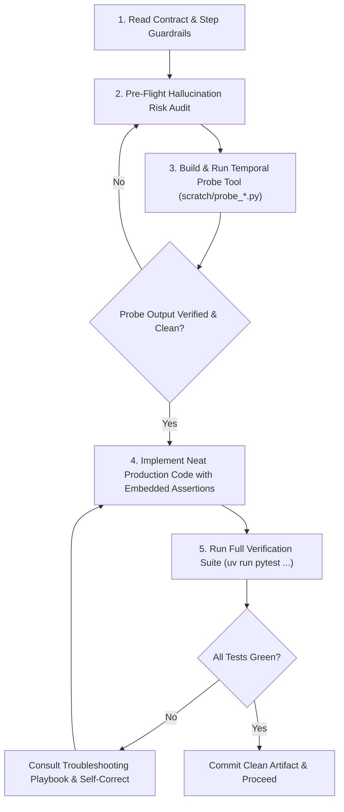

# FlowForge v2 — Improved Implementation Plan

Ground truth: [v2 Build spec.md](/C:/Users/juanc/Desktop/FlowForge/v2%20Build%20spec.md). This plan keeps the spec's research questions (RP1–RP6), elegance rule, and methodology. It only tightens sequencing, fallback triggers, and verification.

> **Operational Directive for Non-Expert / Constrained Models (Muse Spark, Wonder):**
> Constrained agents behave like junior engineers: they cannot make unguided assumptions about APIs, tensor math, or schemas without risking hallucinations. Every task below provides **concrete code contracts, exact mathematical formulas, pinned library versions, typed Pydantic schemas, shell commands, explicit pass/fail tolerances, enforceable step-by-step guardrails, and a self-directed probing protocol**.

---

## 1. Operating Rules & Self-Directed Guardrail Protocol

Any agent executing this plan must follow the **5-Phase Atomic Task Loop with Self-Imposed Guardrails & Temporal Probing**:



### Self-Directed Guardrail & Temporal Probing Protocol
Before generating or modifying production files, the agent **MUST** explicitly execute two defensive engineering practices:

#### 1. Pre-Flight Hallucination Risk Audit
The agent must ask itself and document:
* *"Where am I most vulnerable to hallucinating in this task?"* (e.g., assuming a Pydantic v1 method in v2, guessing OpenFOAM boundary dictionary keys, inverting matrix transpose indices, assuming unverified NumPy broadcasting dimensions, or introducing unhandled division by zero).
* *"What validation assertions must I embed directly into the code?"* (e.g., tensor symmetry asserts, trace-freedom asserts, array shape asserts, positive-definite checks, non-null guards).

#### 2. Temporal Probing Tool Pattern
When faced with external libraries (`foamlib`, `sympy`, `zarr`, `openai`), complex tensor operations, or CLI commands:
* The agent must **NOT** write speculative production code directly into `flowforge/`.
* Instead, the agent must write and execute an ephemeral probe script in `scratch/probe_<task_name>.py`.
* The probe executes the isolated call, prints exact shapes/types/exit codes, and verifies the assumption against reality.
* Once the behavior is verified on the real system, the agent translates that confirmed logic into neat, robust, well-factored production code with embedded assertions.

### Core Agent Operating Guardrails
- **Zero Mathematical Improvisation:** All tensor formulas, Pope bases, invariant normalization constants, and barycentric coordinate calculations are pre-derived in this plan. Implement them exactly as written.
- **Strict Data Vault Isolation:** The directory `data/locked/` is isolated from the swarm. Agents must never write tools, scripts, or unit tests that access `data/locked/` except via the dedicated, access-logged evaluator (`scripts/evaluate_locked.py`).
- **Pydantic v2 Everywhere:** All agent responses, tool inputs/outputs, and configuration registries must validate against Pydantic models with `model_validate`.
- **Deterministic Randomness:** All stochastic components (NumPy, Scikit-Learn, train/val splits) must default to `seed=42`.
- **Approved Tech Stack:**
  - Python 3.12 managed via `uv`
  - Core Math: `numpy`, `scipy`, `sympy`, `scikit-learn`
  - Solver & Storage: `foamlib`, `zarr` (v2.x), `duckdb`
  - LLM Runtime: Meta Model API via `openai` Python SDK (models: `muse-spark-1.3`, `muse-code`, `wonder`)
  - Server & UI: `fastapi`, `uvicorn`, `websockets`, React 18, TypeScript, TailwindCSS, Plotly.js, KaTeX

---

## 2. Goal and success criteria

Build one Python system that runs agent research groups against a local OpenFOAM farm, with a React UI on top. Headline result is RP1: does red-team training improve held-out generalization (mean + spread, wins and losses)? Success = reproducible baseline, oracle/zero tests decided by Oct 27, minimal pipeline with append-only event log, one full research round, red-team + useful demo UI, and 3-arm × 3-seed comparative table with ≤3 locked evaluations.

---

## 3. Recommended approach

Critical path (in order, gates are hard stops):

1. Reproducible OpenFOAM baseline (k-omega SST) on periodic hills, matching dataset RANS within a pre-frozen tolerance.
2. Zero-correction identity test and fixed-field oracle test.
3. One hand-written correction end to end, then one generated + compiled from the closure language.
4. Minimal reproducible pipeline: append-only `events.jsonl`, cost tracking, content-addressed caching, replay without API calls.
5. One complete research round using the Meta Model API (budget-capped, schema-validated).
6. Red-team evaluation + demonstration UI (useful, not complete).
7. Comparative experiments (with/without red team + sparse-regression baseline) and reproducibility checks.

Owners: A = physics/OpenFOAM (C++ class, cases, meshing, rungs, attacks). B = agents/API/UI (DSL, pipeline, prompts, FastAPI, Model Lab). Shared: experiments, freeze, submission.

### Fallbacks (pre-committed, not negotiated mid-run)

- **Per-candidate compile blocks progress** → outer loop: Python recomputes correction fields between short solver runs. Header/labels unchanged.
- **Oracle test fails by end of Oct 27** → frozen-RANS-only evaluation for the rest of the hackathon. Every table/figure is labeled `frozen | short | full`. Frozen scores are never presented as full-solver results.

### Scientific guardrails (frozen before any results)

- Elegance margin 3%, snapping tolerance 1%, rung-0 rotation/limits tolerances, and baseline-match tolerance live in `configs/` and are committed before experiments.
- Locked test in `data/locked/`, evaluator-only, access-logged, ≤3 milestone evaluations. Red-team generated flows are validation, never training.
- ≥3 seeds per arm. Report spread. Baseline SST is re-run in-container for every headline comparison.

---

## 4. Folder architecture (implemented by this scaffold)

```text
flowforge/ (repo root)
├── README.md, pyproject.toml
├── docker/                 openfoam.Dockerfile, compose.yaml
├── docs/plans/             this plan
├── configs/experiments/    baseline, swarm, swarm_no_redteam, sparse_baseline
├── configs/                budgets.yaml, cases.yaml
├── data/{raw,processed,locked,literature}/     git-ignored
├── openfoam/src/correctedKOmegaSST/, templates/{periodicHill,squareDuct,channel,flatPlate,bump}/, meshing/
├── flowforge/{dsl,physics,data,solver,ladder,redteam,elegance,composer,agents,orchestrator,literature,render,api}/
├── library/{modules,attacks,rejected,findings}/
├── prompts/, ui/src/{pages,components,state,api}/
├── runs/ (git-ignored), notebooks/, scripts/, tests/{unit,integration,science}/
```

Data and run outputs stay out of git. Candidate ID = hash of canonical expression + constants. Run ID = hash of candidate + case + mesh + solver settings. Event log at `runs/<session>/events.jsonl` stores prompt versions, responses, runs, scores.

---

## 5. Agent harnesses (4 capabilities + 1 shared runtime)

A harness is a closed loop: typed task, independent ground truth, deterministic scoring, hard budget, full trace. A prompt alone is not a harness. Folders:

- `flowforge/agents/runtime/` — shared runtime: model router, budget meter, retries, tool registry wiring, event-log writes. Harnesses consume it; they never reimplement auth or retries.
- `flowforge/agents/tools/` — typed tool registry (`fit_constants`, `eval_apriori`, `search_cards`, solver/field tools). Every tool is schema-validated and budget-metered.
- `flowforge/agents/harness/research/` — literature cards + mechanism proposals. Pass: card parses in SymPy, mechanism cited in source card, prediction testable before any solver run.
- `flowforge/agents/harness/physics/` — invariants, tensor basis, realizability, limits. Pass: rotation, symmetry, trace-free, barycentric, zero-strain checks. No LLM self-grading.
- `flowforge/agents/harness/symbolic/` — DSL, fitting, snapping, elegance (description length). Pass: SymPy round-trip, a priori error vs frozen-RANS, snapping cost within tolerance.
- `flowforge/agents/harness/solver/` — foamlib/Docker/field I/O via the evaluation ladder. Pass: exit code, convergence, field hashes, time and cost recorded.
- `flowforge/agents/evals/` — versioned regression sets per capability (positive + negative controls, thresholds fixed before runs).
- `library/curriculum/` — worked examples and failure cards agents learn from, separate from `library/modules/` and `library/findings/`.
- `tests/agents/` — harness regression tests; a prompt or tool change that drops a score blocks merge.

Every harness task carries: pydantic-style typed contract, success threshold fixed pre-run, hard budget (tokens, solver seconds, dollars), locked-data isolation, and one `events.jsonl` trace (prompt hash, response, tool calls, scores, cost). Negative controls are mandatory: a harness that only rewards hits teaches guessing. Red team stays a role on physics+solver until it earns a separate harness.

### Meta Model API Architecture & Cookbook Patterns
In accordance with the official [meta-models/meta-model-cookbook](https://github.com/meta-models/meta-model-cookbook):
1. **Client Setup:** Use the OpenAI Python SDK pointing to Meta Model API:
   ```python
   import os
   from openai import OpenAI

   client = OpenAI(
       base_url="https://api.meta.ai/v1",
       api_key=os.environ["MODEL_API_KEY"],  # "LLM|{numeric_id}|{secret}"
   )
   ```
2. **Model Assignment by Role:**
   - **Research Board:** `muse-spark-1.3` with high reasoning tokens (`reasoning_effort="high"`).
   - **Theorist, Analyst, Skeptic, Red Team Lead, Composer:** `muse-spark-1.3` (1M+ context window enables full library and card injection).
   - **Coder:** `muse-code` (or `muse-spark-1.3` fallback).
3. **Structured Outputs:** Enforce strict JSON output using cookbook recipe `01_api_fundamentals/04_structured_output.ipynb` (`response_format={"type": "json_object"}` with Pydantic validation).
4. **Multi-Agent Orchestration:** Follow cookbook recipe `03_use_cases/08_multi_agent_orchestration/`: agents communicate via structured findings board comments and task dependency sequencing, recording all actions to an auditable JSONL event trace on disk.

---

## 6. Steps

### S0 Toolchain probe + Phase 0 recovery
python/uv/docker versions, `simpleFoam` smoke. Proves environment before code depends on it. Also owns what no step owned before: GitHub/Kaggle/Meta accounts, `pyproject.toml` dependencies (NumPy, SciPy, SymPy, foamlib, FastAPI, uvicorn, pydantic, tenacity), `scripts/download_data.py` execution into `data/raw/` with SHA-256 manifest, Closure Challenge clone + README format check, and CI at `.github/workflows/ci.yml` (lint + unit tests + one tiny OpenFOAM case per push). Acceptance: versions printed, dataset manifest exists, CI green on skeleton.

#### Hand-Holding Micro-Tasks for S0:
* **S0.1 Environment & Dependencies (`pyproject.toml`):**
  Populate `pyproject.toml` with the exact pinned dependencies:
  ```toml
  [build-system]
  requires = ["setuptools>=68", "wheel"]
  build-backend = "setuptools.build_meta"

  [project]
  name = "flowforge"
  version = "0.1.0"
  description = "Agent research groups against a local OpenFOAM farm"
  requires-python = ">=3.12"
  dependencies = [
      "numpy>=1.26.0,<2.0.0",
      "scipy>=1.12.0",
      "sympy>=1.12",
      "scikit-learn>=1.4.0",
      "foamlib>=0.4.0",
      "zarr>=2.17.0,<3.0.0",
      "fastapi>=0.110.0",
      "uvicorn[standard]>=0.28.0",
      "websockets>=12.0",
      "pydantic>=2.6.0",
      "tenacity>=8.2.3",
      "openai>=1.14.0",
      "pyvista>=0.43.0",
      "duckdb>=0.10.0",
      "pyarrow>=15.0.0",
      "pandas>=2.2.0",
      "pyyaml>=6.0.1",
      "httpx>=0.27.0",
      "pdfplumber>=0.11.0",
  ]
  [project.optional-dependencies]
  dev = ["pytest>=8.0.0", "pytest-asyncio>=0.23.0", "ruff>=0.3.0", "mypy>=1.9.0"]
  ```
  *Verification Command:* `uv sync`
  *Pass Criteria:* Resolves and generates `uv.lock`.

* **S0.2 Configuration Specs (`configs/budgets.yaml`, `configs/cases.yaml`):**
  - `configs/budgets.yaml`:
    ```yaml
    session_dollar_limit: 50.00
    roles:
      board: { model: "muse-spark-1.3", max_tokens: 2048, temperature: 0.2, reasoning: high }
      theorist: { model: "muse-spark-1.3", max_tokens: 2048, temperature: 0.7 }
      coder: { model: "muse-code", max_tokens: 2048, temperature: 0.1 }
      analyst: { model: "muse-spark-1.3", max_tokens: 2048, temperature: 0.3 }
      skeptic: { model: "muse-spark-1.3", max_tokens: 2048, temperature: 0.5 }
      redteam: { model: "muse-spark-1.3", max_tokens: 2048, temperature: 0.8 }
      composer: { model: "muse-spark-1.3", max_tokens: 2048, temperature: 0.2 }
    solver_caps:
      max_solver_runs_per_round: 10
      short_run_timeout_seconds: 60
      full_run_timeout_seconds: 300
    ```
  - `configs/cases.yaml`: Register 6 cases with split assignments:
    - Train: `periodic_hill_re5600`, `periodic_hill_re10595`
    - Validation: `curved_step`, `converging_diverging_channel`
    - Locked: `square_duct`, `nasa_wall_mounted_hump`

* **S0.3 Ingestion Script (`scripts/download_data.py`):**
  Implement dataset downloader pulling from Kaggle / Closure Challenge benchmark with SHA-256 manifest generation in `data/raw/manifest.json`. Include `--synthetic-fallback` flag for zero-network CI test passes.
  *Verification Command:* `uv run python scripts/download_data.py --synthetic-fallback`

* **S0.4 Docker OpenFOAM Probe (`docker/`):**
  *Verification Command:* `docker run --rm opencfd/openfoam-default:latest simpleFoam -help`
  *Pass Criteria:* Displays OpenFOAM banner and exit code 0.

#### Step S0 Guardrails & Anti-Patterns (Enforced for Muse Agents):
- `[SELF-AUDIT]` **Hallucination Risk Check:** Verify that Python 3.12 compatibility flags are respected; do not assume Python 3.11-only or deprecated typing syntaxes.
- `[TEMPORAL PROBE]` **Probe Package Resolution:** If adding any helper utility, execute `python -c "import <pkg>; print(<pkg>.__version__)"` in scratch before adding it to `pyproject.toml`.
- `[CRITICAL]` **Do NOT add floating or unpinned package versions** (e.g. `"*"`, `"latest"`) to `pyproject.toml`. All dependencies must strictly match the declared version bounds.
- `[FORBIDDEN]` **Do NOT import heavy or non-approved ML frameworks** (such as PyTorch, TensorFlow, JAX, Polars, or alternative web frameworks like Flask/Django). Stick strictly to `numpy`, `scipy`, `sympy`, `scikit-learn`, and `fastapi`.
- `[CRITICAL]` **Do NOT skip SHA-256 checksum verification.** Any raw download file whose SHA-256 does not match `data/raw/manifest.json` must be rejected immediately.
- `[FORBIDDEN]` **Do NOT alter case split designations in `configs/cases.yaml`** after creation. Cases categorized as `locked` must remain locked for the entirety of the project lifecycle.
- `[MUST]` **Offline CI Execution:** `scripts/download_data.py --synthetic-fallback` must be capable of generating valid local synthetic arrays without network access so unit tests can execute in air-gapped CI environments.

---

### S1 Baseline
`scripts/run_experiment.py` (baseline config) runs SST on periodic hills in container. Acceptance: profile error vs dataset RANS < frozen tolerance; run hash cached.

#### Hand-Holding Micro-Tasks for S1:
* **S1.1 Template Setup (`openfoam/templates/periodicHill/`):**
  Ensure standard `0/`, `constant/`, `system/` OpenFOAM case files exist with `kOmegaSST` configured in `constant/turbulenceProperties` and periodic boundary conditions in `system/blockMeshDict`.
* **S1.2 Async Solver Runner (`flowforge/solver/runner.py`):**
  Implement `OpenFOAMSolverRunner`:
  ```python
  @dataclass
  class SolverRunResult:
      case_path: Path
      converged: bool
      iterations: int
      wall_time_seconds: float
      fields: dict[str, np.ndarray]  # 'U', 'p', 'k', 'omega'
      run_hash: str
      error_message: str | None = None
  ```
* **S1.3 Baseline SST Run:**
  Execute `scripts/run_experiment.py --config configs/experiments/baseline.yaml`.
  *Pass Criteria:* Periodic hill runs to convergence; velocity profile error against dataset RANS is below frozen threshold $\epsilon_{\text{base}} = 0.05$.

#### Step S1 Guardrails & Anti-Patterns (Enforced for Muse Agents):
- `[SELF-AUDIT]` **Hallucination Risk Check:** Agents often hallucinate OpenFOAM mesh dimensions or boundary patch names (e.g., calling cyclic boundaries `inlet/outlet` instead of `cyclic`). Inspect `system/blockMeshDict` directly.
- `[TEMPORAL PROBE]` **Probe Solver Execution (`scratch/probe_solver.py`):** Launch a 10-iteration dry run of `simpleFoam` on a tiny mesh using `subprocess.run` to confirm container volume mounts and exit codes before building `OpenFOAMSolverRunner`.
- `[CRITICAL]` **Do NOT execute OpenFOAM without hard wall-clock timeouts.** Every invocation must specify `timeout_seconds` (maximum 180s for short/coarse runs, 300s for full runs). Never launch unmonitored solver background processes that can hang indefinitely.
- `[FORBIDDEN]` **Do NOT modify standard k-omega SST model coefficients** in `openfoam/templates/periodicHill/constant/turbulenceProperties` (standard $\beta^* = 0.09$, $\sigma_k = 0.85$, $\sigma_\omega = 0.5$, $\beta_1 = 0.075$).
- `[CRITICAL]` **Convergence Verification:** A run cannot be marked converged if pressure residual $r_p > 10^{-4}$ or velocity residual $r_U > 10^{-4}$. Non-converged runs must be flagged as `converged=False`.
- `[FORBIDDEN]` **Do NOT parse OpenFOAM fields using ad-hoc string splitting or regex.** Use `foamlib` or structured array parsers to extract fields (`U`, `p`, `k`, `omega`).
- `[MUST]` **Content-Addressed Run Caching:** Before executing `simpleFoam`, compute the run hash: `sha256(case_name + mesh_hash + solver_settings)`. If a cached result with this hash exists on disk, return it immediately without calling Docker.

---

### S2 Identity + oracle
`tests/integration` — zero correction identical to baseline (field diff 0); DNS-corrected velocity error < baseline by pre-set margin. Gate Oct 27; failure triggers frozen fallback.

#### Hand-Holding Micro-Tasks for S2 (CRITICAL HARD GATE):
* **S2.1 C++ Closure Class (`openfoam/src/correctedKOmegaSST/`):**
  Mathematical implementation inside OpenFOAM:
  $$\tau_{ij}^{\text{corrected}} = \tau_{ij}^{\text{SST}} + 2 k a_{ij}^\Delta$$
  $$P_k^{\text{corrected}} = \min(G, 10 \beta^* k \omega) + \Delta P_k$$
  Implement two modes:
  - **Mode A (Fixed Field Mode):** Reads `aDelta` (`volSymmTensorField`) and `PkDelta` (`volScalarField`) from `0/` time directory.
  - **Mode B (Compiled Code Mode):** Evaluates inline C++ generated by SymPy compiler.
* **S2.2 Zero-Correction Identity Test (`tests/integration/test_identity.py`):**
  Set $a_{ij}^\Delta = 0$ and $\Delta P_k = 0$.
  *Pass Criteria:* $\|U_{\text{corrected}} - U_{\text{baseline}}\|_\infty < 10^{-6} \text{ m/s}$.
* **S2.3 DNS Oracle Test (`tests/integration/test_oracle.py`):**
  Compute true DNS correction targets $a_{ij}^{\Delta, \text{target}}$ and $\Delta P_k^{\text{target}}$ from dataset; inject via Mode A; run solve.
  *Pass Criteria:* $\text{RMSE}(U_{\text{oracle}}, U_{\text{DNS}}) \le 0.70 \times \text{RMSE}(U_{\text{baseline}}, U_{\text{DNS}})$ ($\ge 30\%$ error reduction).
* **Hard Decision Rule:** If Oracle fails or diverges by Oct 27 EOD, activate **Frozen-RANS Fallback**. All subsequent rungs grade offline on precomputed targets, avoiding runtime compiler blockers.

#### Step S2 Guardrails & Anti-Patterns (Enforced for Muse Agents):
- `[SELF-AUDIT]` **Hallucination Risk Check:** C++ compilation inside OpenFOAM is brittle; agents commonly hallucinate OpenFOAM macro names (`tmp<fvMatrix>`, `correctNut()`). Verify against standard OpenFOAM ESI headers.
- `[TEMPORAL PROBE]` **Probe C++ wmake Compilation (`scratch/probe_wmake.sh`):** Compile a minimal stub C++ turbulence model in Docker using `wmake libso` to verify include paths and compilation flags before coding `correctedKOmegaSST`.
- `[CRITICAL]` **Zero-Correction Precision:** The identity test must pass strictly with difference $< 10^{-6}$. An agent must never artificially loosen this threshold to $10^{-3}$ or $10^{-2}$. If the diff is nonzero, the C++ injection logic is defective.
- `[FORBIDDEN]` **Do NOT create unphysical turbulence production:** Production correction $P_k^{\text{corrected}}$ must never fall below zero ($P_k^{\text{corrected}} \ge 0$). Clamp with `max(0.0, Pk_corrected)` inside the C++ class.
- `[CRITICAL]` **Safe Division in C++:** In any C++ expression, every denominator must be guarded against division by zero using `max(denom, 1e-6)`. Division by zero crashes OpenFOAM with `Floating point exception (core dumped)`.
- `[MUST]` **Adherence to the Hard Gate (Oct 27 EOD):** If the Oracle test fails to reduce velocity RMSE by at least 30%, or if C++ compilation exceeds 90 seconds, the agent **MUST immediately commit the Frozen-RANS Fallback**. Do NOT spend days debugging OpenFOAM linker errors; switch to offline frozen target scoring.

---

### S3 DSL → candidate
`flowforge/dsl` (grammar, SymPy compile, complexity ≤25), `flowforge/physics` (invariants, tensor basis, frozen targets), `flowforge/elegance` (rung-0 checks, description length, snapping). Hand-written first, then generated + compile-time measured. Acceptance: round-trip, invariance, tensor-basis symmetry/trace-free tests pass.

#### Hand-Holding Micro-Tasks for S3:
* **S3.1 Mathematical Physics (`flowforge/physics/tensors.py`):**
  Normalized tensors: $s = \frac{1}{\omega} \frac{1}{2}(\nabla U + (\nabla U)^T)$, $\omega^* = \frac{1}{\omega} \frac{1}{2}(\nabla U - (\nabla U)^T)$.
  - **5 Pope Scalar Invariants:**
    $$I_1 = \text{Tr}(s^2), \quad I_2 = \text{Tr}(\omega^{*2}), \quad I_3 = \text{Tr}(s^3), \quad I_4 = \text{Tr}(\omega^{*2} s), \quad I_5 = \text{Tr}(\omega^{*2} s^2)$$
  - **4 Pope Tensor Bases:**
    $$T^{(1)} = s, \quad T^{(2)} = s \omega^* - \omega^* s, \quad T^{(3)} = s^2 - \tfrac{1}{3}\text{Tr}(s^2)I, \quad T^{(4)} = \omega^{*2} - \tfrac{1}{3}\text{Tr}(\omega^{*2})I$$
  - **Barycentric Map Realizability Check:**
    Eigenvalues of anisotropy $b_{ij}$: $\lambda_1 \ge \lambda_2 \ge \lambda_3$.
    $C_1 = \lambda_1 - \lambda_2$, $C_2 = 2(\lambda_2 - \lambda_3)$, $C_3 = 3\lambda_3 + 1$.
    Assert $C_1, C_2, C_3 \ge -10^{-4}$ and $C_1 + C_2 + C_3 = 1$.
* **S3.2 SpaRTA Target Derivation (`flowforge/physics/frozen_rans.py`):**
  $$a_{ij}^{\Delta, \text{target}} = b_{ij}^{\text{DNS}} - b_{ij}^{\text{SST}}, \quad \Delta P_k^{\text{target}} = -2 k (a_{ij}^{\Delta, \text{target}} : S_{ij})$$
* **S3.3 Closure DSL Grammar & Parser (`flowforge/dsl/`):**
  Expressions: $a_{ij}^\Delta = \sum_{n=1}^4 g^{(n)}(I_1..I_5) T^{(n)}_{ij}$, $\Delta P_k = 2 k (a_{ij}^\Delta : S_{ij}) \cdot h(I_1..I_5)$.
  Atomic operators: `+`, `-`, `*`, `div(a, b) = a / (b**2 + 1e-4)`, `tanh`, `exp`, `sqrt(abs(a) + 1e-4)`, integer powers.
  Node complexity: $\sum \text{nodes}(g^{(n)}) + \text{nodes}(h) \le 25$.
* **S3.4 Elegance Engine & Snapping (`flowforge/elegance/engine.py`):**
  - Hard filters (Rung 0): Invariance under random 3D rotation $Q$, zero-strain limit $S \to 0 \implies a^\Delta \to 0$, complexity $\le 25$.
  - Description length (MDL): $DL = N_{\text{nodes}} \log_2(N_{\text{vocab}}) + \sum \text{bits}(c)$.
  - Constant snapping: Try rationals $\{0, \pm 1, \pm 2, \pm 0.5, \pm 0.333, \pm 1.5\}$. Keep snap if $\Delta \text{Error} \le 1\%$.
  - Champion rule: Among models within 3% worst-case error of best, pick minimum $DL$.
  *Verification Command:* `uv run pytest tests/unit/test_dsl.py tests/unit/test_physics.py -v`

#### Step S3 Guardrails & Anti-Patterns (Enforced for Muse Agents):
- `[SELF-AUDIT]` **Hallucination Risk Check:** Agents often confuse tensor contraction order or generate non-orthogonal bases. Explicitly embed `assert np.allclose(T, T.transpose(0,2,1))` for symmetric bases and `assert np.allclose(np.trace(T, axis1=1, axis2=2), 0)` for tracelessness.
- `[TEMPORAL PROBE]` **Probe SymPy Parsing (`scratch/probe_sympy.py`):** Write an isolated test parsing 5 sample candidate string expressions into SymPy AST and verifying node counts before writing `flowforge/dsl/parser.py`.
- `[CRITICAL]` **Mathematical Invariance of Anisotropy:** The anisotropy correction tensor $a_{ij}^\Delta$ must be mathematically symmetric ($a_{ij}^\Delta = a_{ji}^\Delta$) and traceless ($\sum_{i=1}^3 a_{ii}^\Delta = 0$). Any proposal violating symmetry or trace-freedom must be rejected instantly at Rung 0.
- `[FORBIDDEN]` **Complexity Violations:** An agent must never propose or accept an expression with tree complexity $> 25$. If an LLM theorist proposes a polynomial with 28 nodes, `flowforge/dsl/parser.py` must reject it without passing it to fitting or the solver.
- `[CRITICAL]` **Smoothness & Safe Division:** Raw division `/` and square root `sqrt()` are strictly forbidden in the grammar. Agents must only use `div(a, b) = a / (b**2 + 1e-4)` and `sqrt(abs(a) + 1e-4)` to prevent asymptotic blow-ups.
- `[FORBIDDEN]` **Unjustified Snapping:** Do not snap constants if the worst-case error increases by more than 1.0% ($1.01 \times \text{Error}$). Snapping must balance simplicity with fidelity.
- `[MUST]` **Zero-Strain Limit:** At zero strain ($S_{ij} = 0$), all invariants $I_1, I_3, I_4, I_5$ vanish. The correction $a_{ij}^\Delta$ must evaluate to 0 in this limit.

---

### S4 Pipeline (split so the Oct 27 gate is honest)
**S4a, due Oct 27 with S2** — Meta Model API client in `flowforge/agents/runtime/` (OpenAI SDK format, pydantic schemas, tenacity retries, budget meter), append-only `runs/<session>/events.jsonl`, replay mode that re-feeds recorded responses at zero token cost. **S4b** — content-addressed caching, `flowforge/data` lock enforcement, `flowforge/orchestrator` round bookkeeping. Acceptance: replay reproduces a recorded session without API calls; leakage test (agent tool reading `data/locked`) is refused + logged; every API call logs prompt hash, tokens, dollars.

#### Hand-Holding Micro-Tasks for S4:
* **S4.1 Zarr Data Storage (`flowforge/data/zarr_store.py`):**
  Create Zarr hierarchy per case: `/coordinates`, `/cell_volumes`, `/wall_distance`, `/U`, `/p`, `/k`, `/omega`, `/grad_u`, `/invariants/I1..I5`, `/tensor_basis/T1..T4`, `/targets/a_delta, Pk_delta`.
* **S4.2 Data Split Guard (`flowforge/data/split_guard.py`):**
  Raise `PermissionError` and log to `runs/vault_access.log` if any swarm tool attempts to read `data/locked/`.
* **S4.3 Meta Model Client (`flowforge/agents/runtime/client.py`):**
  OpenAI SDK client targeting `https://api.meta.ai/v1`, Tenacity retry backoff, Pydantic validation, and dollar budget tracker.
* **S4.4 Event Logger & Replay (`flowforge/agents/runtime/event_logger.py`):**
  Append-only `runs/<session>/events.jsonl`. When `FLOWFORGE_REPLAY=1`, intercept calls and return stored outputs matching prompt SHA-256.
  *Verification Command:* `uv run pytest tests/unit/test_runtime.py tests/unit/test_split_guard.py -v`

#### Step S4 Guardrails & Anti-Patterns (Enforced for Muse Agents):
- `[SELF-AUDIT]` **Hallucination Risk Check:** Agents often hallucinate Pydantic v1 syntax (e.g. `BaseModel.parse_raw()`) instead of Pydantic v2 (`BaseModel.model_validate_json()`). Verify against Pydantic v2 documentation.
- `[TEMPORAL PROBE]` **Probe Meta Model API Client (`scratch/probe_meta_api.py`):** Run a standalone 1-token call to `https://api.meta.ai/v1` using `muse-spark-1.3` to verify authorization header formatting and token usage extraction.
- `[CRITICAL]` **Data Leakage Security:** Under no circumstances may an agent tool read, search, or import files from `data/locked/`. Any attempt to access `data/locked/` by a role must throw `PermissionError` and record an unauthorized access attempt in `runs/vault_access.log`.
- `[FORBIDDEN]` **Unmetered API Calls:** Agents must never call `client.chat.completions.create` directly without passing through `ModelRuntime`. Every API call must increment the role token meter and dollar ledger in `configs/budgets.yaml`.
- `[CRITICAL]` **Dollar Limit Enforcement:** If the session dollar spend exceeds `$50.00`, `ModelRuntime` must immediately raise `BudgetExceededError` and halt swarm execution.
- `[MUST]` **Zero-Cost Replay Integrity:** In replay mode (`FLOWFORGE_REPLAY=1`), network calls must be disabled. If an event hash is missing from `events.jsonl` during replay, raise an error; do not silently make a live API call.
- `[FORBIDDEN]` **Mutable Event Logs:** `runs/<session>/events.jsonl` is strictly append-only. Never overwrite, edit, or truncate an event log file.

---

### S5 Round + ladder + literature
role prompts/schemas in `prompts/` (one versioned file per role: board, theorist, coder, analyst, skeptic, red-team lead, composer), successive halving in `flowforge/ladder/` (rung 1 a priori → rung 2 short → rung 3 full), canonical cases channel + flat plate in `openfoam/templates/`, and the previously orphaned literature path: `flowforge/literature/` (arXiv/OpenAlex/Semantic Scholar + NASA pages, pdfplumber extraction, closure cards into `data/literature/`, research-harness scoring). FastAPI in `flowforge/api/` streams events over websockets; the server paces the stream by default at ~20 events/s (~50 ms apart, first event promptly) whether or not the client asks for pacing or a count, so a bare subscribe cannot burst. Acceptance: one group completes a full round unattended and fully logged; a bare websocket subscribe (no pacing, no count) shows server-paced arrivals when timed; top-30 cards reviewed by the physics owner.

#### Hand-Holding Micro-Tasks for S5:
* **S5.1 Successive Halving Ladder (`flowforge/ladder/ladder.py`):**
  - Rung 0: Symbolic & limits check (0s).
  - Rung 1: A priori MSE vs Zarr targets (seconds). Top 50% advance.
  - Rung 2: Short RANS (coarse mesh, 60s cap). Top 50% advance.
  - Rung 3: Full RANS on all training cases + realizability checks.
  - Minimax score: $\max_{c} \frac{\text{RMSE}(U_M, U_{\text{DNS}})_c}{\text{RMSE}(U_{\text{SST}}, U_{\text{DNS}})_c}$.
* **S5.2 Typed Role Prompts (`prompts/`):**
  Define versioned YAML prompt files with Pydantic schemas:
  `board.yaml` (`RoundPlan`), `theorist.yaml` (`CandidateProposal`), `coder.yaml` (`FitResult`), `analyst.yaml` (`AnalysisReport`), `skeptic.yaml` (`SkepticCritique`), `redteam.yaml` (`AttackSpec`), `composer.yaml` (`CompositionPlan`).
  - **Embedded Self-Guardrails in Prompts:** Every role prompt must instruct the LLM to output a `risk_audit` field identifying potential failure modes before returning code.
* **S5.3 Literature Harvester (`flowforge/literature/`):**
  Extract equations via `pdfplumber` into `ClosureCard` objects in `data/literature/`.
* **S5.4 Unattended Orchestrator Loop (`flowforge/orchestrator/round.py`):**
  Run complete round loop: Board $\to$ Theorist $\to$ Coder $\to$ Rungs 0–3 $\to$ Analyst/Skeptic $\to$ Red Team $\to$ Composer.
* **S5.5 FastAPI WebSocket Streamer (`flowforge/api/server.py`):**
  Stream `events.jsonl` over WebSocket `/ws/events` paced at 50ms intervals (~20 events/s).
  *Verification Command:* `uv run python -m flowforge.orchestrator.round --mock-llm --round 1`

#### Step S5 Guardrails & Anti-Patterns (Enforced for Muse Agents):
- `[SELF-AUDIT]` **Hallucination Risk Check:** Agents often hallucinate that WebSocket broadcast handles backpressure automatically. Explicitly implement an `asyncio.sleep(0.05)` pacing throttle in the broadcaster.
- `[TEMPORAL PROBE]` **Probe WebSocket Broadcast (`scratch/probe_ws.py`):** Connect an async test client to the FastAPI WebSocket endpoint; assert that events arrive spaced at ~50ms intervals rather than dumping 100 events in 1 millisecond.
- `[CRITICAL]` **No Free-Form Agent Chat:** Every prompt must return schema-validated JSON conforming to its Pydantic model (`CandidateProposal`, `RoundPlan`, etc.). If an LLM response contains conversational banter or unparsed markdown, run exactly one repair retry; if it fails again, drop the proposal.
- `[FORBIDDEN]` **No Skipping Evaluation Rungs:** A candidate cannot jump straight to Rung 2 or Rung 3 without first passing Rung 0 (symbolic hard filters) and Rung 1 (a priori screening). Successive halving must drop the bottom 50% at each stage.
- `[CRITICAL]` **WebSocket Event Pacing:** Never blast all session events in a single instantaneous burst. The server must pace stream delivery to 50ms intervals (~20 events/s) so browser clients can process and render frames smoothly.
- `[FORBIDDEN]` **No Web Scraping Violations:** Follow robots.txt and API rate limits when collecting literature from arXiv / OpenAlex. Cache all responses locally in `data/literature/`; never hammer external endpoints in a tight loop.
- `[MUST]` **No Model Self-Grading:** Agents (Theorist, Coder) are never permitted to score their own candidates. Scoring is calculated exclusively by deterministic Python algorithms in `flowforge/ladder/ladder.py`.

---

### S6 Red team + UI + composer
first bootstrap the UI so it can run at all (`ui/package.json`, Vite + React + TypeScript, TanStack Query, Tailwind, Plotly.js, KaTeX; `npm run dev` serves the app). Then hill slopes/Re sweeps/bumps generator, permanent attack suite in `library/attacks/`, PyVista renders (+SAM only if endpoint confirmed), and the previously unowned composer: `flowforge/composer/` gated composition + gate fitting, paying description length per gate, scored on all training flows (Nov 1 gate). UI pages: mission control, generalization matrix, candidate inspector, vault, replay. Each harness regression set in `flowforge/agents/evals/` gets its positive/negative fixtures filled here at the latest, with `library/curriculum/` examples linked. Acceptance: red team breaks ≥1 candidate, visible in UI; composed closure scored on all training flows or RP4 is explicitly cut; `npm run dev` + one live-streamed session visible end to end.

#### Hand-Holding Micro-Tasks for S6:
* **S6.1 Red Team Generator (`flowforge/redteam/generator.py`):**
  Deform periodic hill steepness ($\alpha \in [0.5, 1.5]$), sweep Reynolds numbers, and record broken candidates in `library/attacks/`.
* **S6.2 Gated Composer (`flowforge/composer/gates.py`):**
  Combine surviving modules: $a_{ij}^{\text{composite}} = \sigma(w \cdot I + b) a_{ij}^{(M_1)} + (1 - \sigma(w \cdot I + b)) a_{ij}^{(M_2)}$. Add 16 bits DL penalty per active gate.
* **S6.3 Model Lab UI Cockpit (`ui/`):**
  Vite + React 18 + TailwindCSS + Plotly.js + KaTeX.
  5 views:
  1. *Mission Control:* Active research groups, token/budget meter, live red team attack feed.
  2. *Generalization Matrix:* Candidates vs Flows heatmap (Train, Generated, Locked greyed out).
  3. *Candidate Inspector:* KaTeX formula, velocity profiles vs DNS/SST, barycentric map, PyVista error maps.
  4. *Vault:* Locked test milestones and access logs.
  5. *Replay:* Timeline scrubber for zero-token demo reproduction.
  *Verification Command:* `cd ui && npm install && npm run build`

#### Step S6 Guardrails & Anti-Patterns (Enforced for Muse Agents):
- `[SELF-AUDIT]` **Hallucination Risk Check:** In React with TypeScript, agents often invent non-existent Tailwind utility classes or mix up Plotly trace object schemas. Verify against official Plotly.js / KaTeX types.
- `[TEMPORAL PROBE]` **Probe UI Build (`scratch/probe_ui_build.sh`):** Test Vite building an empty React page with Tailwind before writing the multi-view cockpit components to ensure no bundling/alias issues.
- `[CRITICAL]` **Attack Flow Segregation:** Red-team generated geometries (varied slopes, perturbed bumps) must never be added to the training set. They belong exclusively to validation / attack verification.
- `[FORBIDDEN]` **Free Gating:** A composite closure cannot add gates without paying the description length penalty. Every sigmoid gate incurs a strict +16 bit penalty to prevent over-parameterized piecewise memorization.
- `[CRITICAL]` **Zero Physics in React:** The UI is strictly a read-only cockpit. Never perform Navier-Stokes solves, coordinate rotations, or tensor algebra in TypeScript. All physics computation belongs in Python backend services.
- `[MUST]` **Clean UI Compilation:** `npm run build` must complete with zero TypeScript errors and zero unresolved CSS references. Do not leave placeholder components with missing imports.
- `[FORBIDDEN]` **Do NOT block the Nov 1 Gate:** If gated composition (RP4) shows numerical instability or fails to outperform single closures by Nov 1 EOD, trigger the cut order: drop the composer and ship the best single champion closure.

---

### S7 Experiments
3 arms × 3 seeds in parallel on two machines, locked milestones, mesh-refinement check. Acceptance: complete results table incl. losses; champion re-run reproduces scores from hashes alone.

#### Hand-Holding Micro-Tasks for S7:
* **S7.1 3-Arm Execution:**
  - Arm 1: Full Swarm (with Red Team)
  - Arm 2: Swarm Ablation (No Red Team)
  - Arm 3: Sparse Regression Baseline (same solver budget)
  Run 3 seeds each (9 total runs).
* **S7.2 Locked Milestone Evaluation:**
  Run `scripts/evaluate_locked.py` strictly at Milestone 1, Milestone 2, and Final Champion. Record access reasons in audit log.
* **S7.3 Mesh Refinement Check:**
  Double mesh resolution on periodic hill for champion candidate; verify worst-case error shifts by $< 2\%$.
* **S7.4 Final Packaging:**
  Cut demo video from Replay interface; assemble README reproduction commands; submit before Nov 4, 14:00 ET.

#### Step S7 Guardrails & Anti-Patterns (Enforced for Muse Agents):
- `[SELF-AUDIT]` **Hallucination Risk Check:** Agents often forget to freeze random seeds across multiple experiment arms. Verify that `seed=42`, `seed=43`, `seed=44` are passed explicitly and logged.
- `[TEMPORAL PROBE]` **Probe Seed Reproducibility (`scratch/probe_seed.py`):** Run two iterations with the same seed and confirm byte-identical candidate hashes before starting the 9-run sweep.
- `[CRITICAL]` **No Cherry-Picking:** When reporting the 3-arm benchmark, agents must report the complete statistical spread (mean ± standard deviation across all 3 seeds). Negative results and failed attacks must be reported with equal rigor.
- `[FORBIDDEN]` **More than 3 Locked Evaluations:** The locked test set (`data/locked/`) may only be evaluated a maximum of 3 times throughout the entire project (Milestone 1, Milestone 2, and Final Submission). Repeated querying is considered scientific data snooping and is strictly prohibited.
- `[CRITICAL]` **Explicit Score Labeling:** Never present frozen-RANS targets or short-run RANS scores as full converged solutions. Every published table and figure must carry the explicit label `frozen | short | full`.
- `[MUST]` **Deterministic Reproducibility:** Any outsider running `python scripts/reproduce_champion.py` with the logged champion hash must arrive at the exact same velocity profile errors within numerical floating-point tolerances ($< 10^{-5}$).
- `[FORBIDDEN]` **Feature Additions Past Freeze:** No code refactoring, new swarm roles, or algorithmic changes are permitted after the Nov 1 feature freeze. Phases 5 and 6 are strictly for experiments, validation, video cutting, and submission packaging.

---

## 7. Schedule (Oct 26 – Nov 4; submission Nov 4, 21:00 ET)

| Date | Gate | Milestone |
|---|---|---|
| Oct 26 | — | Repo skeleton, CI skeleton, dataset + Closure Challenge format confirmed (Phase 0 debt recovered). |
| Oct 27 | **Phase 1** | C++ class + compile time; zero + oracle tests; S4a API client + event log + replay. **EOD:** full-solver vs frozen-only decision. |
| Oct 28 | — | Short/full rungs, physics checks, channel + flat plate. |
| Oct 29 | **Phase 2** | One full round unattended + fully logged. Tolerances frozen in git. |
| Oct 30 | — | Red-team generator + attack suite; renders. |
| Oct 31 | **Phase 3** | Red team breaks ≥1 candidate, visible in UI. |
| Nov 1 | **Phase 4** | Composer/gates only if S1–S6 green (first cut is RP4). Feature freeze EOD. |
| Nov 2 | — | Arms in parallel, seeds 1–2 on both machines. |
| Nov 3 | **Phase 5** | Seed 3, locked milestones, mesh check, results table. Buffer starts EOD. |
| Nov 4 | Submit ~14:00 | Demo video from Replay, README with reproduce commands. 7 h buffer. |

Cut order if slipping: RP4 composer/gates → SAM segmentation → UI polish. Never cut seeds, the no-red-team arm, or locked-set discipline.

---

## 8. Validation plan

Exact checks per gate: unit `pytest tests/unit` (DSL round-trip, invariance, realizability, feature recomputation); integration `pytest tests/integration -k "zero or oracle"` (zero identical, oracle closer to DNS); pipeline leakage + replay tests; API schema-valid/parse/duplicate rates on recorded responses; numerical mesh-refinement tolerance on champion; science gate = 3-arm table with mean/spread. No gate passes on a hand-run demo — each needs its command + output.

---

## 9. Risks and open decisions

Highest risk: OpenFOAM baseline reproducibility and the per-candidate compile loop. Compile time is unmeasured — F1/S3 must time it before the ladder depends on it. Decisions needing owners: ESI version pin (recommend closest-to-v2006), frozen-fallback acceptance, outer-loop default (recommend outer loop until compile time proven), scope-cut order, Meta model IDs/SAM endpoint, Muse Code data terms. All tooling claims remain **assumed** until the probe commands run on a working shell.

---

## 10. Agent Troubleshooting & Self-Correction Playbook

| Failure Mode / Exception | Root Cause | Exact Remedy for Agent |
| :--- | :--- | :--- |
| `simpleFoam` diverges (`Floating point exception`) | Anisotropy eigenvalues violate realizability. | Catch divergence; return penalty score $10^6$; write rejection card to `library/rejected/`. |
| SymPy complexity $> 25$ | Expression generated too many AST operators. | Rung 0 filter rejects candidate; prompts Theorist with error message to prune terms. |
| Meta Model API `429 Too Many Requests` | Burst requests from multi-agent round. | Tenacity exponential backoff activates (1s, 2s, 4s, 8s); max concurrent requests clamped to 3. |
| Zarr dimension mismatch | OpenFOAM mesh cell count differs from target array. | Check `cell_volumes` and grid interpolation in `flowforge/data/zarr_store.py`. |
| C++ compiler failure on candidate | Division by zero or unhandled token in SymPy C++ output. | Verify SymPy C++ printer substitutes `div(a,b)`; if compiler errors persist, trigger Outer-Loop field mode. |
| WebSocket disconnects in UI | Uvicorn restarted or network timeout. | TanStack Query reconnects with 1s exponential backoff; UI displays status badge. |
